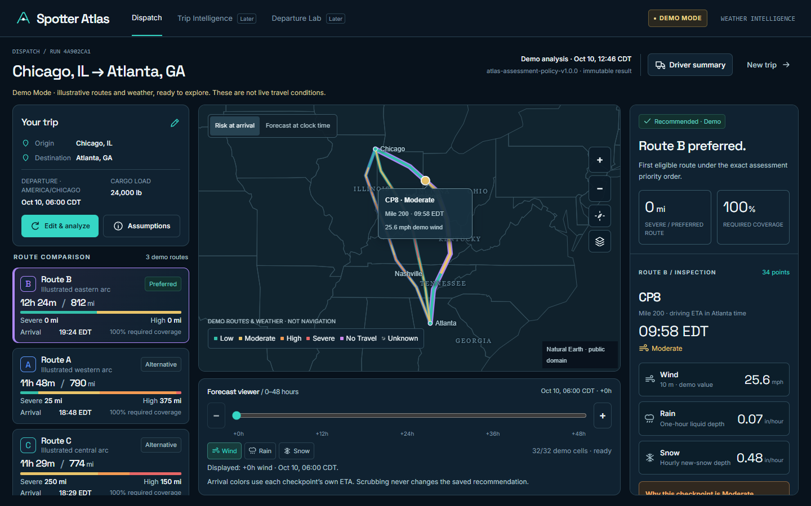
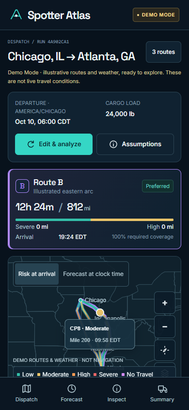
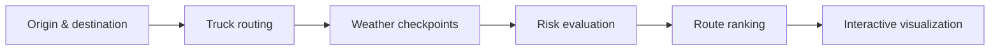

# Spotter Atlas

**Intelligent Truck Routing, Powered by Weather Intelligence.**

Spotter Atlas brings truck-aware route planning, hourly weather forecasts and route-specific hazard inspection into one dispatch workspace. Compare alternatives, see conditions at each checkpoint's modeled arrival time, and understand the exposure behind every recommendation—all through **Atlas Noir**, its dark geospatial interface.

[](https://github.com/ShyanCS/Atlas/actions/workflows/ci.yml)

[Features](#key-features) · [Getting started](#getting-started) · [Architecture](#architecture) · [Data sources](#data-sources-and-limitations) · [Roadmap](#roadmap)

**[Open the hosted assessment demo](https://spotter-atlas-assessment.pages.dev/)** — reviewer access required. The hosted release uses labeled sample scenarios; live-provider access remains disabled. [Deployment verification](docs/deployment/AUTOMATED_DEPLOYMENT_STATUS.md) · [Hosted screenshots and evidence](docs/deployment/evidence/2026-10-10/README.md)

## Product preview

### Dispatch Canvas



_Route comparison, arrival-time risk segments, checkpoint inspection and the forecast timeline. Preview uses the included demo trip._

### Mobile experience

<p align="center">
  
</p>

_A focused mobile view of the trip, preferred route and operational map, with quick access to forecasts and the driver briefing._

## Key features

| Capability                       | What it delivers                                                                                                                                   |
| -------------------------------- | -------------------------------------------------------------------------------------------------------------------------------------------------- |
| Weather-aware truck routing      | Committed origin/destination coordinates, departure time, physical truck profile and TomTom truck-routing integration.                             |
| Multiple route alternatives      | Compare genuine provider candidates by duration, distance and weather exposure; duplicate or incompatible alternatives are rejected.               |
| Dynamic checkpoint forecasting   | Sample every 10, 25 or 50 miles and match wind, rain and snowfall to checkpoint ETAs.                                                              |
| Cargo-sensitive risk analysis    | Deterministic thresholds and strict cargo-weight overrides, with the applied rules available for inspection.                                       |
| Explainable recommendations      | Compare Severe exposure, High exposure, distance-weighted average risk and travel time in that exact order.                                        |
| Interactive geospatial workspace | MapLibre route selection, differentiated risk segments, weather overlays and detailed hazard/checkpoint inspection.                                |
| 48-hour weather timeline         | Explore 49 hourly positions independently of the saved arrival-time recommendation.                                                                |
| Clear uncertainty handling       | Explicit **Unknown**, incomplete coverage and **No Travel** states; unqualified routes cannot become recommended through selection.                |
| Persistent analysis snapshots    | Completed results and forecast frames persist in PostgreSQL, with immutable calculations and bounded retention. SQLite supports local exploration. |
| Responsive Atlas Noir interface  | Dispatcher-focused desktop composition, mobile trip inspection and a concise driver summary.                                                       |

These capabilities are implemented. The [roadmap](#roadmap) lists the experiences planned next.

## How it works



Django calculates route progress, checkpoint arrival times, weather classifications and distance exposure. It publishes the authoritative recommendation as an immutable analysis. React presents that result: changing the inspected route or forecast hour never changes the ranking.

## Technology stack

| Layer          | Technologies                                                                 |
| -------------- | ---------------------------------------------------------------------------- |
| Frontend       | React, TypeScript, Vite, MapLibre GL JS                                      |
| Backend        | Python, Django REST Framework, PostgreSQL; SQLite for local development      |
| Integrations   | TomTom truck routing/geocoding, Open-Meteo hourly forecasts                  |
| Infrastructure | Cloudflare Pages Free, Render Free and Neon Free                             |
| Verification   | pytest, Vitest, Testing Library, Playwright, Ruff, ESLint and GitHub Actions |

The reviewer-protected Demo Mode release is hosted on Cloudflare Pages, Render and Neon. PostgreSQL persistence, restart recovery, three-route sample ranking and all 49 forecast positions were verified. The live workflow is implemented and previously tested locally; it is not enabled or claimed as verified on the hosted release. Free backend cold starts can delay initial access.

## Getting started

### Explore the demo

The built-in Chicago–Atlanta scenarios let you explore complete weather coverage, missing snowfall and No Travel conditions without external API credentials.

For the hosted demo, request the private reviewer code from the repository owner, paste it into **Private reviewer access code**, then unlock the workspace. The code is an assessment access gate, not a provider API key or a personal account password. It stays in tab memory and must be entered again after reloading. Share it privately with authorized reviewers; never place it in GitHub, screenshots, URLs or frontend configuration. Local development does not require a code unless an access hash is configured.

Requirements: **Python 3.12** and **Node 24.15+ in the 24.x line** (verified with 24.19.0).

Clone the repository:

```sh
git clone https://github.com/ShyanCS/Atlas.git
cd Atlas
```

#### Backend environment — Linux / macOS

```sh
cd backend
python3 -m venv .venv
.venv/bin/python -m pip install -r requirements.lock.txt
.venv/bin/python -m pip install -e . --no-deps --no-build-isolation
```

#### Django migrations and startup

In the same backend terminal:

```sh
.venv/bin/python manage.py migrate
.venv/bin/python manage.py runserver 127.0.0.1:8000 --noreload
```

<details>
<summary>Windows PowerShell backend commands</summary>

From the repository root:

```powershell
cd backend
python -m venv .venv
& .venv/Scripts/python.exe -m pip install -r requirements.lock.txt
& .venv/Scripts/python.exe -m pip install -e . --no-deps --no-build-isolation
```

Then migrate and start Django:

```powershell
& .venv/Scripts/python.exe manage.py migrate
& .venv/Scripts/python.exe manage.py runserver 127.0.0.1:8000 --noreload
```

</details>

#### Frontend installation and startup

Open a second terminal at the repository root:

```sh
cd frontend
npm ci --ignore-scripts
npm run dev
```

Open [Spotter Atlas locally](http://127.0.0.1:5173/) and choose **Explore Demo**. Use the trip form to change cargo weight, checkpoint spacing or the demo scenario.

### Configure live integrations

Server process variables enable live routing and forecasts. Start with [backend/.env.example](backend/.env.example); settings do not automatically load environment files. Keep the TomTom key in the backend environment. The live path also requires the explicit source-policy flags described in the [configuration guide](docs/deployment/SETUP.md).

For a separate frontend/backend deployment, set the public `VITE_API_BASE` to the backend's HTTPS `/api/v1` endpoint. Provider keys, database credentials and reviewer codes stay server-side. Hosted activation uses the separate examples for [Django](backend/.env.deployment.example) and [Vite](frontend/.env.deployment.example).

### Automated tests

From `backend/`, using the virtual environment (Windows: substitute `.venv/Scripts/python.exe`):

```sh
.venv/bin/python -m pytest -q
.venv/bin/python -m ruff check .
.venv/bin/python -m ruff format --check .
.venv/bin/python manage.py check
.venv/bin/python manage.py makemigrations --check --dry-run
.venv/bin/python manage.py spectacular --file openapi.yaml --validate --fail-on-warn
```

From `frontend/`:

```sh
npm run lint
npm run format:check
npm run check:contracts
npm test
npm run build
```

With both local servers running and Google Chrome installed:

```sh
npm run test:browser
```

CI runs the PostgreSQL backend suite, frontend checks/build and demo browser tests without provider credentials. The 10 October 2026 deployment verification recorded **273 PostgreSQL backend tests, 44 frontend tests and seven hosted browser check groups passing**, plus all 147 forecast variable/hour reads. These are dated results, not a claim that every future build passes. [Verification summary](docs/deployment/READINESS.md) · [Browser test guide](frontend/e2e/README.md)

## Architecture

Spotter Atlas is a modular monolith. Provider adapters normalize routing and weather data; trip orchestration generates checkpoints and delegates evaluation to the pure risk engine. Immutable analyses keep the inputs, provenance, exposure and recommendation together. Typed REST contracts connect those results to React state, route inspection and weather visualization.

| Module                     | Responsibility                                                      |
| -------------------------- | ------------------------------------------------------------------- |
| `backend/atlas/providers/` | Provider boundaries, normalization and bounded acquisition          |
| `backend/atlas/domain/`    | Versioned risk policy, route timing, exposure and ranking           |
| `backend/atlas/services/`  | Analysis orchestration, persistence and forecast frame reads        |
| `backend/atlas/api/`       | Validation, serializers, structured errors and OpenAPI              |
| `frontend/src/`            | Typed API client, run-scoped state and Dispatch Canvas presentation |

[API contract](backend/API_CONTRACT.md) · [Backend guide](backend/README.md) · [Frontend guide](frontend/README.md) · [Deployment guide](docs/deployment/SETUP.md)

## Data sources and limitations

- Open-Meteo access is subject to its [provider terms](https://open-meteo.com/en/terms), including noncommercial restrictions on the current Free access. The current integration scope is a personal noncommercial assessment demonstration.
- Provider-reported snowfall is model-derived and approximate, using a fixed 7:1 snow/water relationship. Forecast initialization is not exposed; service-hourly values are not claimed as verified native model intervals.
- Demo scenarios are illustrative. The application visibly distinguishes **Demo Mode** from **Live Analysis** and preserves source attribution and missing-data warnings.
- Route/weather guidance does not guarantee road safety, truck-road legality or dock access. Driving ETAs exclude stops and duty breaks.
- Corridor overlays show sampled forecast locations, not native model-cell boundaries. Coverage and available alternatives can vary by route and forecast window.
- Hosted deployment and public live-provider use have separate activation requirements. See [security](SECURITY.md) and the [release checklist](docs/deployment/SETUP.md).

## Roadmap

Planned next:

- Cinematic Atlas Noir introduction
- Advanced route comparison workspace
- Departure-time intelligence
- Enhanced driver briefing

---

**Spotter Atlas brings weather into route decisions—connecting the road ahead with the conditions that matter along it.**
