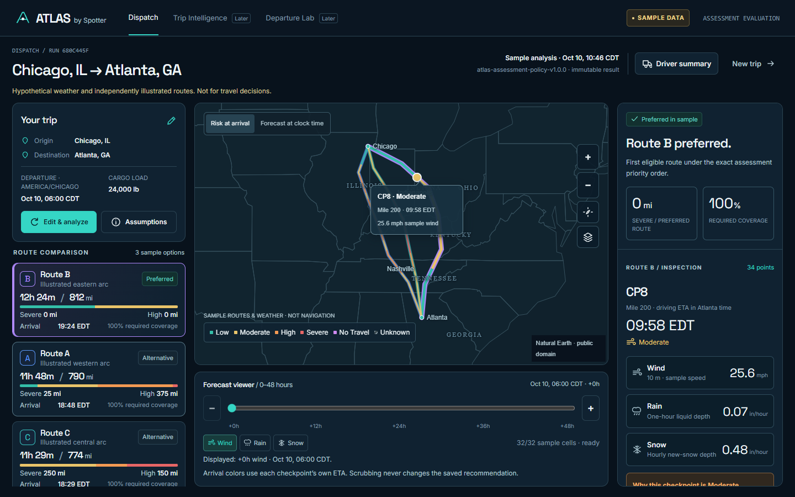

# Spotter Atlas

[](https://github.com/ShyanCS/Atlas/actions/workflows/ci.yml)

Atlas Noir trucking-weather assessment application: React + TypeScript + Vite, Django REST Framework, MapLibre and PostgreSQL support. The backend owns weather classification, checkpoint ETAs, distance exposure, eligibility and route ranking.

**This is a personal noncommercial assessment demonstration.** Publishing source does not enable a hosted application or grant public provider permissions. Hosted live weather/routing default off. No operational travel or navigation safety assurance is made.



## Included functionality

- Explicit sample/live modes, committed geocoding, truck-routing adapters and checkpoint sampling at 10/25/50 miles.
- Deterministic safety policy `atlas-assessment-policy-v1.0.0`: exact thresholds, strict cargo overrides, maximum severity, Unknown/No Travel eligibility, midpoint exposure and lexicographic ranking.
- Backend-authoritative route cards, interactive risk segments/checkpoints, responsive dispatcher/driver views and independent 0–48-hour raw-weather frames.
- Open-Meteo JSON adapter: 10 m wind, liquid rain plus showers and disclosed provider-reported snowfall approximation. Model initialization remains null where unavailable. No native decoder or GPL weather reader is integrated.
- Immutable PostgreSQL analysis results, durable finite provider attempts, reviewer access, throttling, secure hosted settings and prepared free-tier deployment files.

The screenshots and default scenarios use **authored sample data**. Real provider data and credentials are excluded from this repository. Three distinct eligible routes are required for the successful assessment demonstration; fewer candidates or incomplete weather are disclosed rather than fabricated.

## Run locally

Use Python 3.12 and Node 24.15+ in the 24.x line (verified 24.19.0). Start from the repository root.

```sh
cd backend
python -m venv .venv
# Windows: use .venv/Scripts/python.exe; Linux/macOS: .venv/bin/python
.venv/bin/python -m pip install -r requirements.lock.txt
.venv/bin/python -m pip install -e . --no-deps --no-build-isolation
.venv/bin/python manage.py migrate
.venv/bin/python manage.py runserver 127.0.0.1:8000 --noreload
```

In another terminal:

```sh
cd frontend
npm ci --ignore-scripts
npm run dev
```

Open http://127.0.0.1:5173/ and analyze the default sample. No provider credentials are required. Settings read process variables; examples are `backend/.env.example` and `frontend/.env.example`. Never place provider keys, reviewer codes or database credentials in frontend build variables.

Live local use requires separately authorized server credentials and explicit source-policy flags. The provider snowfall relationship is an approximation approved only for this assessment. Do not treat sample outcomes as live weather or turn on public live use without its release confirmations.

## Verify

From `backend/`, using the virtual environment:

```sh
python -m pytest -q
python -m ruff check .
python -m ruff format --check .
python manage.py check
python manage.py makemigrations --check --dry-run
python manage.py spectacular --file openapi.yaml --validate --fail-on-warn
```

From `frontend/`:

```sh
npm run lint
npm run format:check
npm run check:contracts
npm test
npm run build
npm run test:browser
```

Browser tests require the two local servers and installed Google Chrome. CI runs a disposable PostgreSQL service, frontend checks/build and the authored sample browser suite with no provider credentials or deployment step. Local verification results are documented in [source readiness](docs/deployment/READINESS.md); the badge shows actual remote CI status.

## Deployment remains a separate approval

Preferred topology: **Cloudflare Pages Free → Render Free → Neon Free**. Configuration is prepared in `render.yaml`, `frontend/wrangler.toml`, environment examples and the [setup checklist](docs/deployment/SETUP.md). Private reviewer access and public-source confirmation flags remain server-side. No hosting URL or walkthrough exists yet.

[API contract](backend/API_CONTRACT.md) · [Frontend guide](frontend/README.md) · [Security](SECURITY.md) · [Mobile sample preview](docs/screenshots/dispatch.mobile.png)

Cinematic introduction, Route Ledger, Departure Lab and enterprise authentication are deferred. Original research/design packages remain preserved in the author's local workspace. Source publication grants no additional licensing rights; dependencies retain their own licenses.
