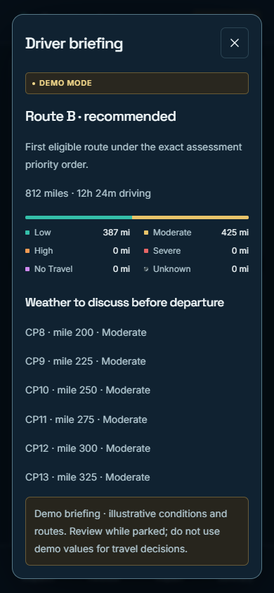

# Hosted Demo Mode evidence — 10 October 2026

These are actual hosted checks of authored sample scenarios, not live provider weather or TomTom geometry. Credentials and private connection strings are excluded. Measurements reflect this run and do not certify production capacity, physical GPUs or Render idle cold starts.

## Final settled screens

### Desktop — 1440×900

### Mobile — 390×844

### Driver briefing — 390×844

## Verification records

| Record                           | Evidence                                                                                                                          |
| -------------------------------- | --------------------------------------------------------------------------------------------------------------------------------- |
| Hosted browser interactions      | [Seven passing check groups](browser/results.json); headless Chrome with SwiftShader                                              |
| Hosted API and forecast coverage | [Three sample scenarios and all 147 frame reads](hosted-verify.json)                                                              |
| Hosted restart persistence       | [Unchanged snapshots and durable budgets](hosted-resume.json)                                                                     |
| Neon migration and TLS           | [Migration](neon-migrate.json), [verification](neon-verify.json), [reconnection](neon-resume.json)                                |
| Render resource sampling         | [Memory/CPU measurements](render-metrics-summary.json)                                                                            |
| Final Pages build                | [Node 24 build and successful publication log](pages-build-summary.json), [deployment submission identity](pages-deployment.json) |
| Known-secret scans               | [Built assets](build-secret-scan.json), [documentation](documentation-secret-scan.json)                                           |

The [deployment report](../../AUTOMATED_DEPLOYMENT_STATUS.md) explains test procedures, performance, limits and configuration differences. No scripts containing credentials are included here. The deployment identity file captures the request while queued; successful publication is established by the build log and subsequent hosted checks.

## Preserved earlier attempts

`dispatch-1440x900.png` and `dispatch-390x844.png` show initial loading rather than the final settled frames. `results-mobile-path-before-correction.json` preserves the browser harness's attempt to click a hidden desktop card; the corrected test used the existing mobile route chooser. `status-before-standalone-access.md` records an earlier access blocker, later resolved. `pages-created.json` records initial project settings; the final build command differs as documented in the deployment report. These are historical records, not current failures or configuration claims.

All relative links and images work in GitHub and after extracting the repository with a Markdown viewer.
