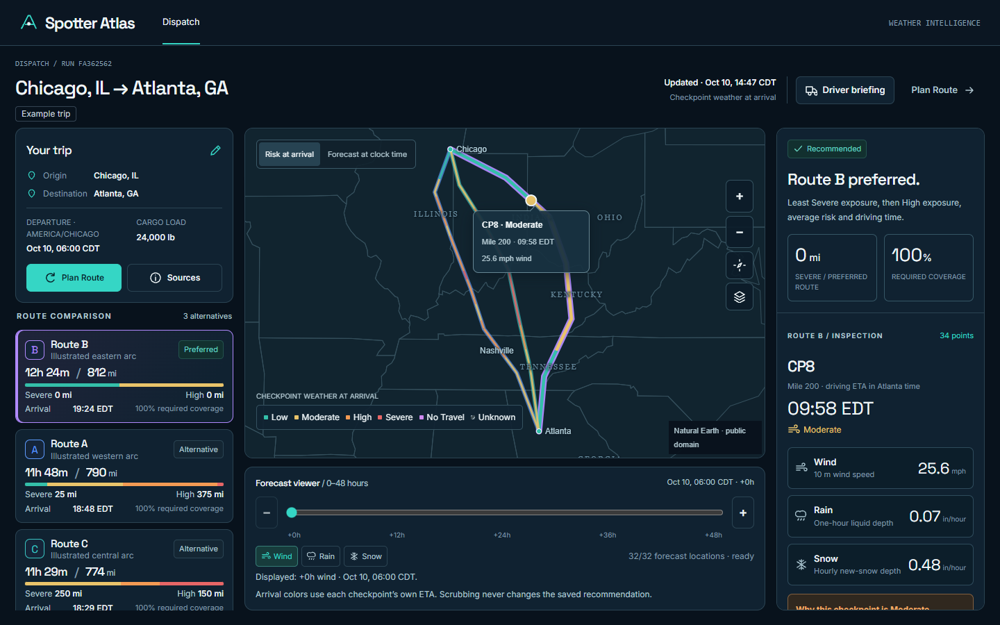
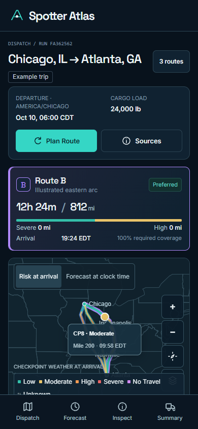

# Hosted direct-entry release evidence

Actual HTTPS tests of the published Pages/Render application, with authored example
data only. No TomTom/Open-Meteo request or private geometry screenshot occurred.

- [API acceptance and 147 frame reads](hosted-verify.json)
- [Verified PostgreSQL TLS baseline](hosted-database.json)
- [Restart persistence and unchanged budgets](hosted-resume.json)
- [Browser results](browser/results.json)
- [Observed Render metrics](render-metrics.json)
- [Final publication/revision verification](final-publication.json)

Desktop 1440×900:

Mobile 390×844:

[Desktop forecast](browser/forecast-1440.png) · [Mobile forecast](browser/forecast-390.png)
· [Restricted desktop planning](browser/planning-1440.png)
· [Restricted mobile planning](browser/planning-390.png)

The initial restart harness compared raw database JSON to serializer-normalized API
timestamps and failed that assertion even though HTTP persistence passed. It was
corrected to compare the same published representation; the fresh SQL/HTTP check
passes. [The initial failed harness result](hosted-resume-before-harness-fix.json)
is retained. Local TLS probing also needed correct percent-encoding of the Windows
CA path; no certificate checking was disabled. No application/data failure was
hidden by these harness corrections.

Chrome used SwiftShader and actual hosted responses. No response mock was used in
these hosted checks. Physical GPU, actual Render idle cold-start and comprehensive
assistive-technology testing are not claimed. Secret/credential material and private
analysis identifiers used by the persistence harness remain outside this package.
