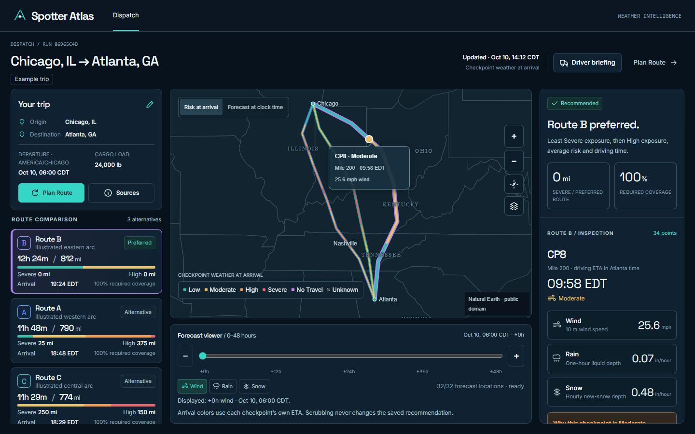
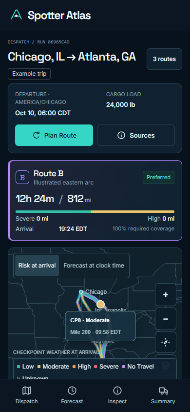

# Product experience review

Local before/after captures using the real Django app and authored example values. No provider geometry or private credentials are included. The after screens await publication approval.

| View                | Before                                                                               | After                                                                |
| ------------------- | ------------------------------------------------------------------------------------ | -------------------------------------------------------------------- |
| Desktop 1440×900    | [Access screen](before/access-1440.png), [Dispatch Canvas](before/dispatch-1440.png) | [Direct Dispatch Canvas](after/dispatch-1440.png)                    |
| Mobile 390×844      | [Access screen](before/access-390.png), [Dispatch Canvas](before/dispatch-390.png)   | [Direct Dispatch Canvas](after/dispatch-390.png)                     |
| Trip planning       | Previously behind the access gate                                                    | [Desktop](after/planning-1440.png), [Mobile](after/planning-390.png) |
| Source transparency | Repeated branding throughout the workspace                                           | [Desktop](after/sources-1440.png), [Mobile](after/sources-390.png)   |
| Driver briefing     | Repeated demo/assessment wording                                                     | [Desktop](after/driver-1440.png), [Mobile](after/driver-390.png)     |

## Desktop

## Mobile

[Browser regression record](regression/results.json) · [Public-access release record](after/release-browser.json) · [Validation summary](validation.json) · [Implementation report](../../PRODUCT_EXPERIENCE_CLEANUP.md)

The public-access harness checks all 147 variable/hour responses once, and keyboard 0/48 positions at both sizes. The simulated 429 quota response and WebGL failure preserve explicit test labels. The controlled startup delay tests feedback rather than real hosted performance. Images show headless Chrome software WebGL. Relative links work in GitHub and local Markdown viewers.
